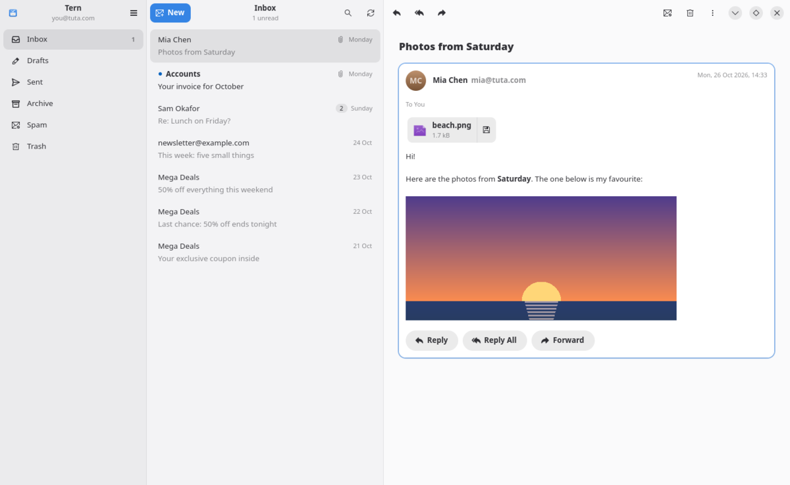
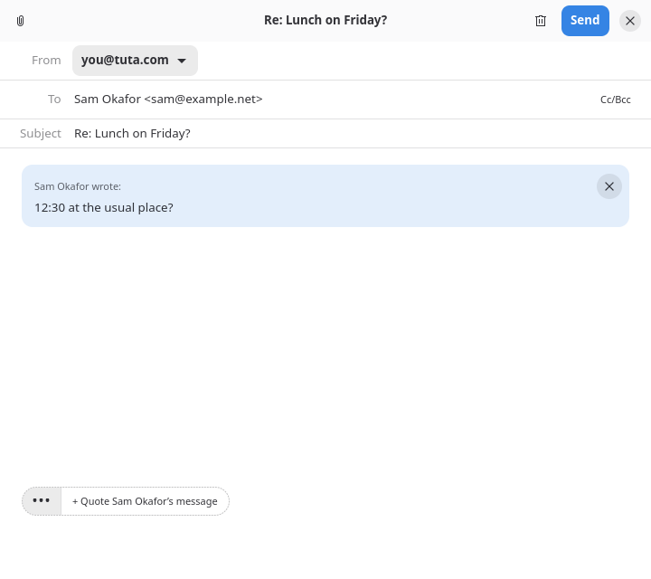
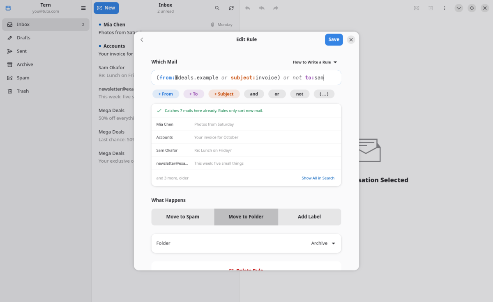
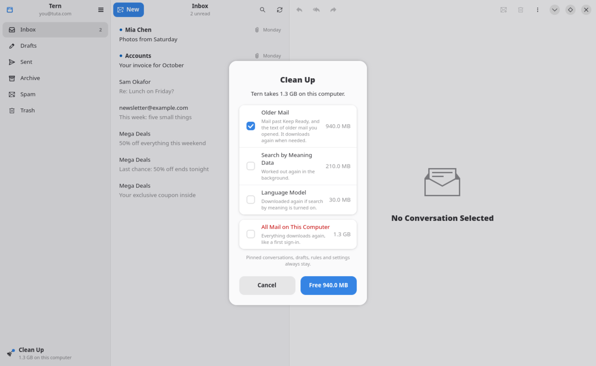

<p align="center">
  
</p>

<h1 align="center">Tern</h1>

<p align="center">
  <strong>A small, fast GNOME mail client for Tuta.</strong><br>
  Native GTK 4 and libadwaita, written in Rust. Unofficial; not affiliated with Tuta GmbH.
</p>

<p align="center">
  <a href="https://github.com/OceanEilonwy/tern/actions/workflows/ci.yml"></a>
  <a href="https://github.com/OceanEilonwy/tern/actions/workflows/release.yml"></a>
  <a href="https://github.com/OceanEilonwy/tern/releases/tag/latest-main"></a>
  <a href="LICENSE"></a>
</p>

<p align="center">
  <a href="#install"><b>Install</b></a> ·
  <a href="https://github.com/OceanEilonwy/tern/releases/tag/latest-main"><b>Downloads</b></a> ·
  <a href="DECISIONS.md"><b>Decisions</b></a>
</p>

<p align="center">
  <picture>
    <source media="(prefers-color-scheme: dark)" srcset="docs/readme/reading-dark.png">
    
  </picture>
</p>

<table>
  <tr>
    <td width="33%"><picture><source media="(prefers-color-scheme: dark)" srcset="docs/readme/reply-dark.png"></picture></td>
    <td width="33%"><picture><source media="(prefers-color-scheme: dark)" srcset="docs/readme/rule-dark.png"></picture></td>
    <td width="33%"><picture><source media="(prefers-color-scheme: dark)" srcset="docs/readme/cleanup-dark.png"></picture></td>
  </tr>
  <tr>
    <td align="center">Replies quote only what you pick</td>
    <td align="center">Rules that show what they catch</td>
    <td align="center">Clean Up when the cache grows</td>
  </tr>
</table>

## Why Tern

- **Fast.** Recent mail is kept on your computer in an encrypted database, so folders open at once and work offline.
- **Private.** No web view: mail is drawn natively, remote images never load, and the cache key lives in your keyring.
- **Conversations.** Mail is grouped by subject across folders, with pins, read and unread, and spam from a right-click.
- **Search and rules.** Search everything on this computer, optionally by meaning. Rules sort new mail into folders, labels or Spam.
- **Several addresses.** Send from any alias; a reply starts from the address the mail came to.
- **Keyboard first.** Every action has a shortcut; press Ctrl+? to see them.

## Install

Download from [the latest build](https://github.com/OceanEilonwy/tern/releases/tag/latest-main):

| Your system | Download | Then |
|---|---|---|
| Any distribution with Flatpak: Linux Mint, Ubuntu, Fedora, Void, CachyOS… | `tern-…-x86_64.flatpak` | `flatpak install --user tern-*.flatpak` |
| CachyOS, Arch, Void and other up-to-date distributions | `tern-…-x86_64-linux.tar.gz` | unpack, then `./install.sh` |

Both add Tern to your applications menu with its icon. The tarball needs GTK 4.22 and libadwaita 1.9 or
newer; `./install.sh --uninstall` takes it out again. Flatpak fetches the GNOME runtime from Flathub the
first time.

To try it without an account, type `demo` as the address on the sign-in screen.

## Build from source

```bash
git clone https://github.com/OceanEilonwy/tern.git
cd tern
./install.sh --deps     # shows the command that installs what the build needs on your distribution
./install.sh            # builds, then installs Tern with its menu entry and icon into ~/.local
```

`./install.sh` checks for Rust, GTK 4.22 and libadwaita 1.9 first and says what is missing. Run
`sudo PREFIX=/usr/local ./install.sh` to install for everyone, and `./install.sh --uninstall` to take it
out again. To update, `git pull` and run `./install.sh` again.

For working on Tern:

```sh
make run          # sign in with your Tuta address and password
make demo         # in-memory demo account, no network
make test         # unit tests, plus the window checks on a headless display (more in docs/TESTING.md)
```

Not supported yet: two-factor sign-in, and password-protected mail to people outside Tuta.

`crates/app` is the GTK app, `crates/cache` the encrypted cache and sync, `crates/tuta` the Tuta account,
and `vendor/tuta-sdk` Tuta's own Rust SDK with Tern's additions (see `PATCHES.md`).

GPL-3.0, like the Tuta SDK it builds on.
