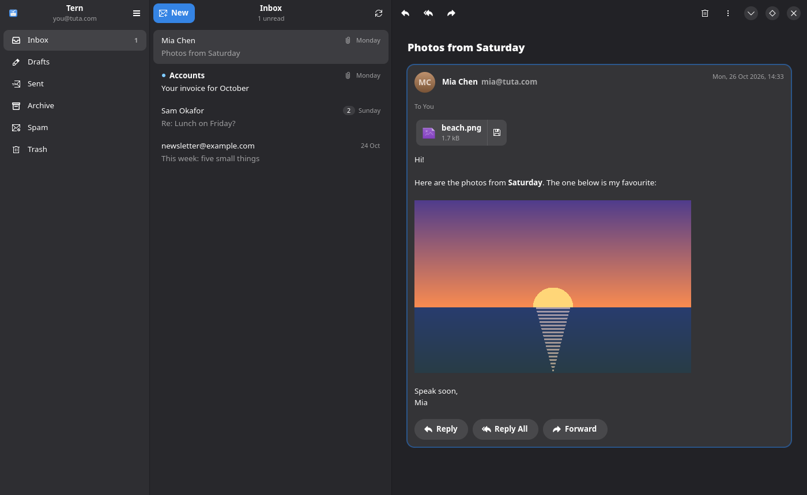

# Tern

A small, fast GNOME mail client for [Tuta](https://tuta.com) mail, in Rust with GTK4 and libadwaita.
Unofficial; not affiliated with Tuta GmbH.

Read and write simple mail, with attachments, as conversations. No WebKit: mail is drawn natively, remote
images are never loaded, and anything too rich has an "Open in Tuta" button.

- **Conversations** group mail by subject across folders; each mail is a card with Reply, Reply All and
  Forward under it.
- **Offline cache**: recent mail is kept on this computer in an encrypted SQLite database (SQLCipher, key in
  the GNOME keyring), so folders open instantly; a background sync checks every five minutes. How much is
  kept is set in Preferences (Low, Medium, High). Signing out deletes it.
- **Drafts**: closing a message keeps it in Drafts; it reopens from its conversation.
- **Suggestions** in To, Cc and Bcc from your contacts and the people you write to.
- **Keyboard**: Alt+Up/Down between conversations, Enter to read, Escape back, Delete, Ctrl+1…9 for
  folders, F9 to fold the folders to icons; Ctrl+? lists them all.
- **Resizable panes**: drag the edge of the folders or the list; drag the folders narrow (or double-click
  their edge) for a rail of icons. Widths are kept.



## Run

```sh
make run          # sign in with your Tuta address and password
make demo         # in-memory demo account, no network
make install      # binary, desktop file and icon into ~/.local
```

Type `demo` as the address on the sign-in screen to try it without an account. Your session (not your
password) is kept in the GNOME keyring; sign out from the main menu.

Not supported yet: two-factor sign-in, password-protected mail to people outside Tuta, search, labels.

## Layout

- `crates/core`: the `Backend` trait the app talks to, shared types, the demo account.
- `crates/tuta`: `Backend` for a Tuta account.
- `crates/cache`: the encrypted mail cache, conversations, address suggestions and the sync.
- `crates/app`: the GTK app.
- `vendor/tuta-sdk`: Tuta's own Rust SDK from a release tag, with Tern's additions; see `PATCHES.md`.

## Test

```sh
make test         # unit tests, plus the window checks on a headless display (kwin_wayland or broadway)
cargo test -p tuta-sdk --features net --lib
TERN_TEST_EMAIL=you@tuta.com TERN_TEST_PASSWORD=… cargo test -p tern-tuta -- --ignored   # live round trip
```

The live test sends you a mail with a PDF attached, finds it in Sent, and compares the attachment bytes.

GPL-3.0, like the Tuta SDK it builds on.
